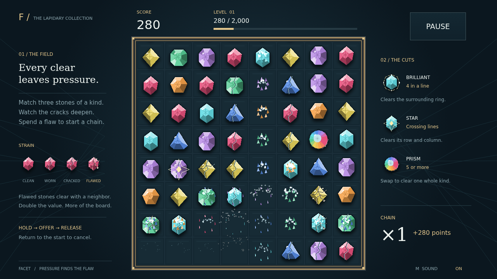

# Facet

A field of beautiful stones. A quiet kind of pressure. Take hold of a gem, offer it to its neighbor, and let go: three or more of one kind in a line shatter into sparkling fragments. Fresh stones tumble into the gaps, and a good move can become a chain all on its own.

Every clear leaves its mark. The stones beside it take strain, their cracks spreading until they are flawed. Touch a flawed stone with your next clear and it joins the shattering, worth double. Let pressure gather in a corner, then find the move that spends it.

Longer matches leave something special behind. Four stones earn a brilliant that clears the ring around it. Crossing lines earn a star that takes its whole row and column. Five or more earn a prism: trade it against a stone to clear every gem of that kind. Each new link in a chain climbs the score multiplier, accompanied by a rising glassy tone.

Reach the target to open the next level, carrying your score onward. The round lasts until the field has no productive move left. Play with a mouse, pen, or finger; carry an offered stone back to where it started whenever you want to reconsider.

